

# Logbook

**Stronger every session.** A strength-training journal for iPhone and Apple Watch: faster logging than the incumbents, with the social layer of Strava and an AI coach that reads your real training data.

Designed, built and shipped solo over 12 months · Submitted to the App Store, November 2026

<!-- Replace once approved -->
**App Store:** _coming soon_ · **Demo video:** _coming soon_

  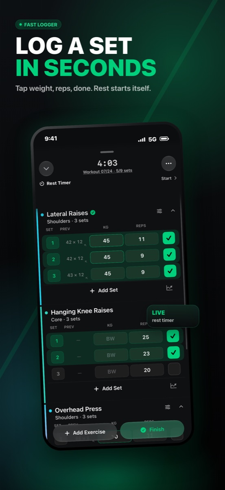
  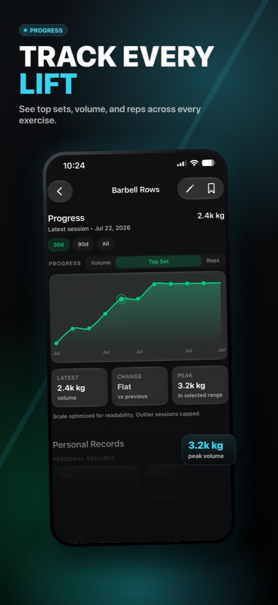
  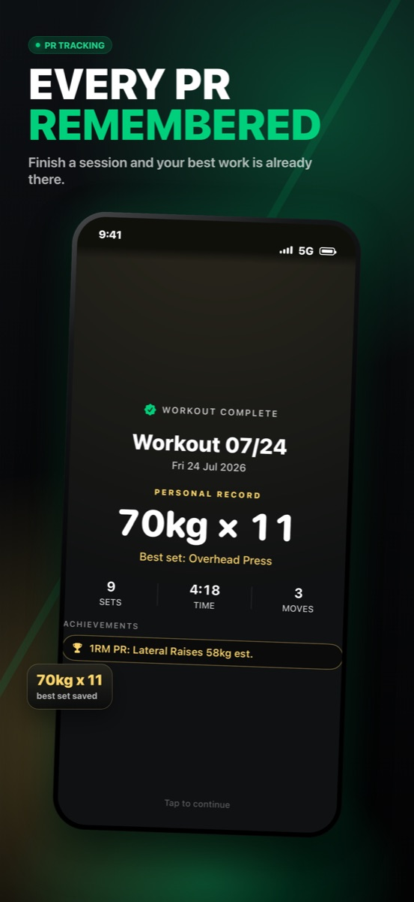
  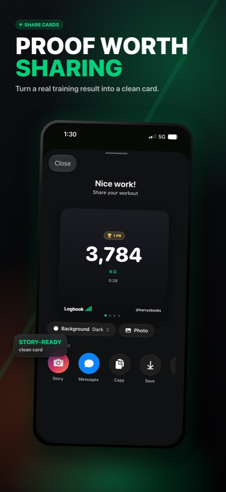
  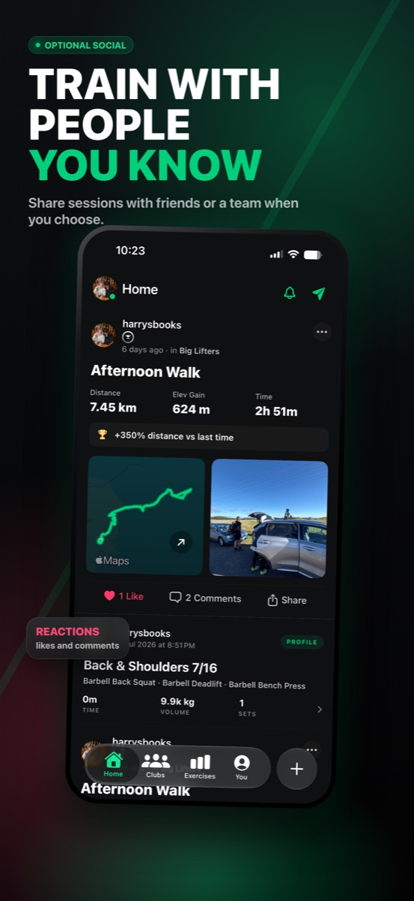

> **About this repo.** Logbook is a commercial app, so its source is private. This repository is the public write-up: what it does, how it is built, and the engineering problems worth talking about. I'm happy to walk through the real code in an interview.

---

## At a glance

| | |
|---|---|
| **Timeline** | November 2025 → November 2026 |
| **Commits** | ~1,180 across 170+ pull requests |
| **Code** | ~650 Swift files (~270k lines) plus a Node.js Cloud Functions backend |
| **Tests** | 1,182 unit tests · 151 UI tests |
| **Targets** | iPhone app · Apple Watch app · Home-screen widgets · Live Activities |
| **Platform** | iOS 18+, with native Liquid Glass on iOS 26 and a designed fallback below it |
| **AI** | In-app coach on Claude (Anthropic API) with strict tool use |
| **Delivery** | GitHub Actions lint gate → merge to `main` → Xcode Cloud → TestFlight |

## What it does

- **Set logging built for speed.** Previous sets inline, one tap per set, rest timer starts by itself, and personal records are detected as you type. The goal: log a full session in under 5 minutes.
- **Progress you can read.** Per-exercise history and graphs, a muscle-coverage chart, weekly recaps and a strength profile.
- **Social when you want it.** Clubs, a friends feed, comments, likes, challenges and Instagram-quality share cards.
- **AI Coach.** Ask questions about *your* training. Coach can build a structured workout plan you can save or start in one tap. ([case study](docs/case-studies/ai-coach.md))
- **Off the phone.** An Apple Watch app for logging and rest timers, a Lock Screen Live Activity, and home-screen widgets (streak, this week, last workout, up next, friends feed).
- **Runs, walks and rides.** GPS recording with route maps, plus HealthKit import.
- **Logbook Pro.** StoreKit subscriptions with a free tier and a 7-day trial.

  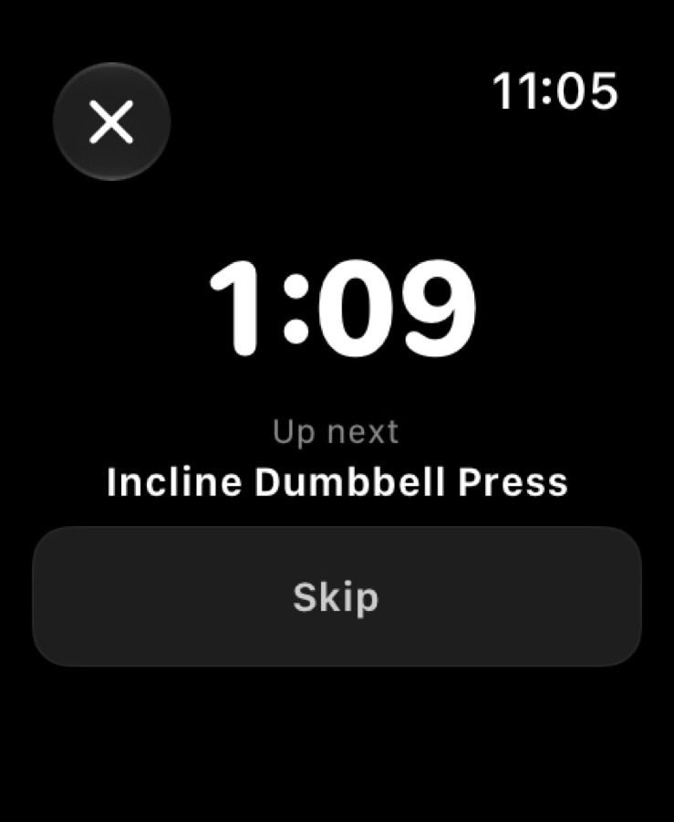
  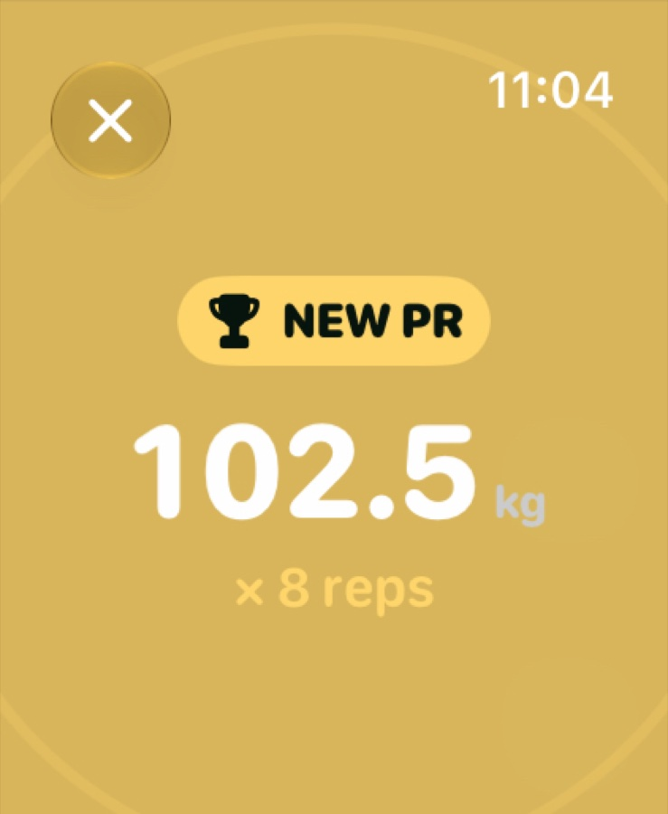
  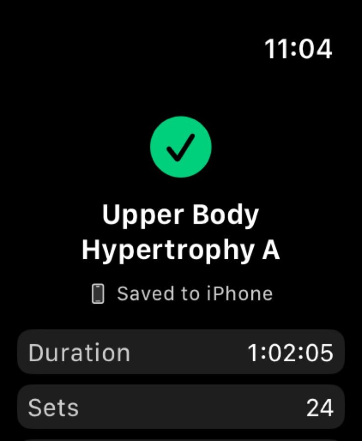
  &nbsp;&nbsp;
  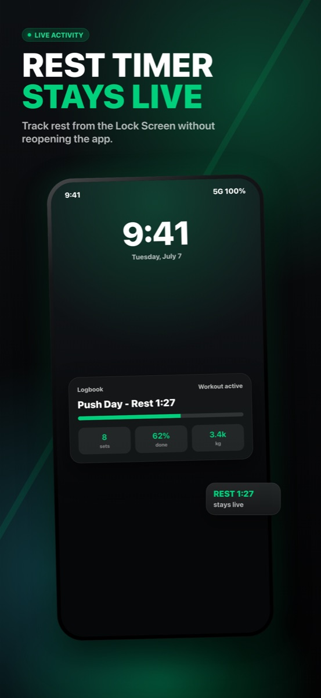
  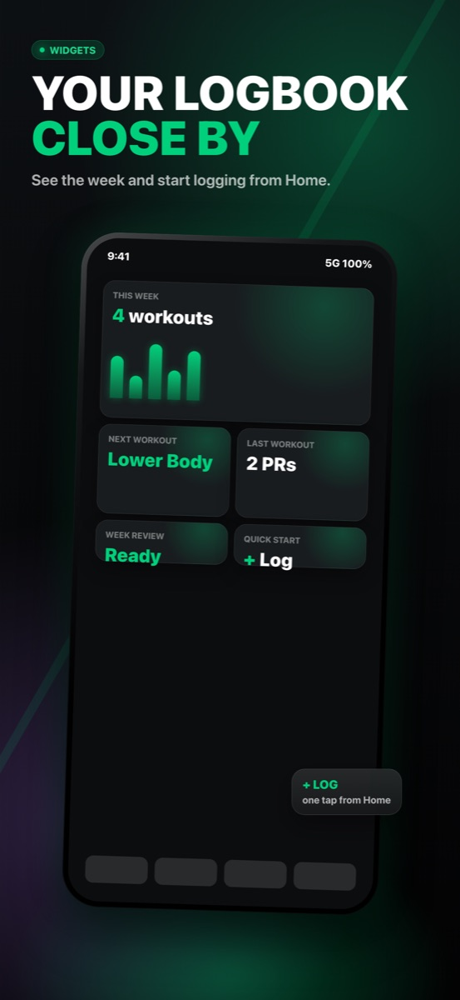

## Architecture

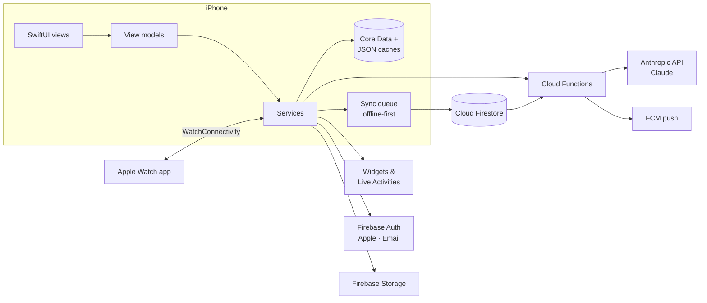

- **MVVM on SwiftUI.** Views stay thin, view models coordinate, and services own persistence, sync and side effects.
- **Offline-first.** Every write lands locally first and goes into a persisted, account-scoped sync queue that retries when the network returns. ([case study](docs/case-studies/offline-first-sync.md))
- **Server-side AI.** The Claude key never ships in the app. A Cloud Function enforces daily limits, chooses which tools to offer and calls the Anthropic API.
- **One design system.** Adaptive colour, type, spacing and radius tokens, enforced by a CI check that fails the build if a raw value creeps back in.

More detail: [docs/architecture.md](docs/architecture.md)

## Engineering case studies

| | |
|---|---|
| 🤖 [**AI Coach on Claude**](docs/case-studies/ai-coach.md) | Grounded prompts from real training data, strict tool use for structured plans, a "no new numbers" rule for generated text, and shipping AI features without breaking older app builds. |
| ⚡ [**A set logger that feels instant**](docs/case-studies/set-logging-performance.md) | Keeping text input under 100 ms in a SwiftUI screen with hundreds of fields. |
| 🔁 [**Offline-first sync**](docs/case-studies/offline-first-sync.md) | A durable write queue, account isolation, and wire formats that survive refactors. |
| 🚨 [**Postmortem: signing in reset a real profile**](docs/case-studies/postmortem-profile-overwrite.md) | A P0 data-loss bug found nine days before launch: root cause, an additive-only fix that doesn't depend on the unproven theory, and why backups now come first. |
| 🛠️ [**Building with AI agents**](docs/case-studies/agentic-engineering.md) | How I ran a 270k-line codebase mostly through Claude Code: project memory, guardrails, and making agents prove their work. |

## Tech stack

- **App:** Swift · SwiftUI · Core Data · WidgetKit · ActivityKit · WatchKit / WatchConnectivity · HealthKit · MapKit & Core Location · StoreKit · Sign in with Apple
- **Backend:** Firebase (Firestore, Auth, Storage, Cloud Functions on Node.js, Cloud Messaging, Crashlytics) · Firestore security rules
- **AI:** Anthropic Claude API (tool use, structured output) · Claude Code for development
- **Quality:** XCTest & XCUITest · SwiftLint · custom design-token lint · GitHub Actions · Xcode Cloud · TestFlight

## About me

I'm Harry Miller. I build products end to end: design, iOS, backend and AI. Before Logbook I spent 18 months at a robotics startup collecting real-world POV data for machine-learning training. I now work in product support with a focus on backend systems, where I built a UiPath automation that turns raw user-activity logs into readable reports for councils across New Zealand and Australia.

<!-- Add contact links: LinkedIn, email, website -->

---

© 2026 Harry Miller. Screenshots and write-ups are shared for portfolio purposes; all rights reserved.
