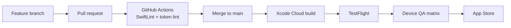

# Architecture

## Layers

| Layer | Responsibility | Examples |
|---|---|---|
| **Views** (SwiftUI) | Rendering and interaction only | `ActiveWorkoutSheet`, `FeedView`, `ExerciseDetailView` |
| **View models** | Screen state, coordinating services | `LogWorkoutViewModel`, `FeedViewModel`, `ClubDetailViewModel` |
| **Services** | Persistence, sync, platform integrations, side effects | `SyncQueueService`, `FirebaseWorkoutService`, `HealthKitService`, `LiveActivityService`, `LogbookAIService` |
| **Design system** | Tokens and shared components | `LogbookColor`, `LogbookFont`, `LogbookSpace`, `logbookGlassSurface` |

## App shell

A root tab view hosts Home, Clubs, Exercises and You, plus a centre "+" action that opens the workout starter rather than a page. The active workout lives *above* the tabs: a mini bar (in the iOS 26 tab bar accessory, or a safe-area inset on iOS 18–25) expands into a floating workout sheet, so you can browse the app mid-session without losing your place.

## Data

- **Local:** Core Data for users, workouts and exercises; JSON caches for history and templates; a draft file for the in-progress workout.
- **Cloud:** Firestore for profiles, workouts, activities, clubs, posts and challenges; Firebase Storage for photos.
- **Sync:** an offline-first persisted queue ([case study](case-studies/offline-first-sync.md)).
- **Backend logic:** Cloud Functions (Node.js) for AI requests, push notifications, club and challenge operations, subscription entitlements and account deletion.

## Platform surfaces

- **Apple Watch:** a standalone logging UI that mirrors the phone session over WatchConnectivity, so sets logged on either device stay in step.
- **Live Activities:** the rest timer and workout progress on the Lock Screen and Dynamic Island.
- **Widgets:** streak, this week, last workout, up next and friends feed. Taps deep-link into the right screen, even from a cold start.
- **HealthKit:** read-only import of workouts, distance and heart-rate data.

## Visual system

iOS 26's Liquid Glass is used natively, with a designed tinted-fill fallback on iOS 18–25, all behind a single modifier so feature code never hand-rolls glass. Every colour token adapts to light and dark mode and is checked for WCAG AA contrast. The brand's signature look is dark, and some surfaces (share cards, celebrations) are pinned dark on purpose.

## Delivery

