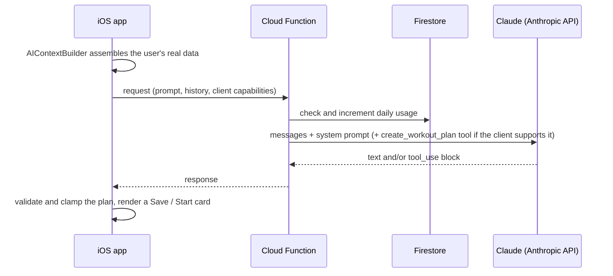

# AI Coach on Claude

Coach is Logbook's in-app training assistant. You can ask it things like *"Why has my bench stalled?"* or *"Build me a 45-minute pull day,"* and it answers from **your actual training history**, not generic fitness advice.

## The problem

A general-purpose chatbot in a fitness app is a liability:

- **It invents numbers.** "You benched 100 kg last week" when you didn't destroys trust immediately.
- **It returns plans as prose or JSON blobs** that the user then has to retype into the app.
- **It costs money per request** and can be abused.
- **Mobile releases are slow.** Users run old app versions for months, so the backend can't assume every client understands new response formats.

## Design

### 1. Grounded context, assembled on device

`AIContextBuilder` builds the system prompt from live data: goal, experience, equipment, recent workouts, personal records, templates, the strength profile and the exercise library. The instructions are blunt: *reference their actual numbers; do not give generic advice.* The model is only as useful as what it can see, so most of the work went into choosing **what** to include and keeping it compact.

### 2. Strict tool use for structured plans

Workout plans come back through a `create_workout_plan` tool with `strict: true` and a closed JSON schema (`additionalProperties: false`, an enum for categories, typed sets with reps and weight). The app turns that straight into a plan card the user can save or start with one tap. Nothing gets copy-pasted.

Some constraints sit outside the strict-schema subset (string `maxLength`, for example). The schema *describes* those limits so the model aims for them, and the **client clamps** as the real guarantee. The model gets close; the code makes it correct.

### 3. "No new numbers" for generated text

The backend also supports a second, tightly bounded mode for one-sentence training verdicts. The app computes the facts deterministically (trends, PRs, volume changes) and sends only those; Claude's job is just to phrase them. (The screen that used it was cut before launch, but the pattern is the one I'd reuse for any generated copy that carries numbers.)

> Use only the deterministic facts supplied. Do not add, change, infer, or restate any number that is not in those facts.

That call also gets its own **200-token ceiling**, separate from chat (2,048), so a runaway generation can't be billed at the chat limit. The split is: the code owns the truth, the model owns the wording.

### 4. Backward-compatible AI releases

The backend offers the plan tool **only to clients that say they can render `tool_use`**. An older build reads `text` only, so a tool-only answer would show up there as a blank message. Gating on client capability means the Cloud Function can deploy *ahead* of the app update without breaking anyone on an older version.

### 5. Cost and abuse controls

- The Anthropic API key lives only in the Cloud Function, never in the app binary.
- Per-user daily limits are enforced server-side in Firestore (5 a day free, 25 on Pro).
- It uses Claude Haiku 4.5: fast and cheap enough for chat, and the tool schema does the heavy lifting on structure.

## What I'd do next

- **An eval suite.** Golden conversations over fixed synthetic training histories, scored for numeric accuracy (every number in a response must trace back to the context) and plan validity.
- **Tap-to-answer follow-ups**, already logged as a post-launch idea.
- **Prompt caching** on the stable part of the system prompt to cut latency and cost on multi-turn chats.
